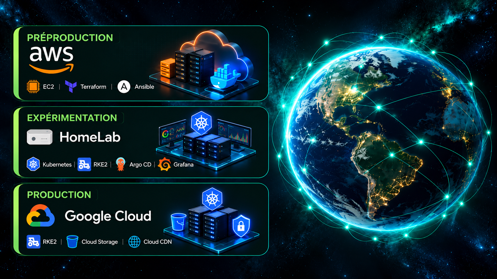

# 🧩 KAREEM DEVOPS STARTER LAB



### Projet DevOps — Infrastructure Cloud, Automatisation et CI/CD

## 🎯 Présentation

**KAREEM DEVOPS STARTER LAB** est un projet DevOps réalisé dans le cadre de ma formation chez **O'clock**.

Il repose sur une application web de type blog, composée d'un frontend développé avec Vue.js, d'un backend développé avec Symfony et d'une base de données PostgreSQL.

L'objectif du projet est de concevoir et d'automatiser une chaîne de livraison applicative, depuis le développement et l'intégration continue jusqu'au provisionnement des infrastructures et au déploiement dans différents environnements.

Ce laboratoire technique met en pratique les principes d'**Infrastructure as Code**, de conteneurisation, d'automatisation, de tests, de **CI/CD**, de GitOps et de supervision.

## 🏗️ Architecture du projet

Le projet s'articule autour de trois environnements complémentaires, permettant de mettre en pratique différentes technologies DevOps.

| Environnement | Plateforme | Objectif |
|---|---|---|
| **Préproduction** | AWS | Provisionnement des infrastructures et déploiement conteneurisé |
| **Expérimentation** | Homelab | Orchestration Kubernetes, GitOps et supervision |
| **Production** | Google Cloud | Infrastructure cloud, orchestration et livraison applicative |

### ☁️ Préproduction — AWS

La préproduction permet de valider et de déployer les composants applicatifs dans un environnement cloud automatisé.

Elle met notamment en œuvre :

- **Terraform** pour provisionner les ressources AWS.
- **Amazon EC2** pour l'hébergement des composants.
- **Ansible** pour automatiser la configuration des serveurs.
- **Docker et Docker Compose** pour exécuter les services applicatifs.
- **Nginx** pour l'exposition des services web.
- **GitHub Actions** pour orchestrer les pipelines CI/CD.
- **Amazon S3** pour le stockage distant des états Terraform.

### 🏠 Expérimentation — Homelab

Le Homelab constitue un environnement de laboratoire dédié à l'expérimentation de technologies d'orchestration et d'exploitation.

Il permet notamment de travailler sur :

- **Kubernetes et RKE2** pour l'orchestration des conteneurs.
- **Argo CD** pour les pratiques GitOps et la synchronisation des déploiements.
- **Grafana** pour la visualisation et la supervision.
- L'administration et l'exploitation d'un environnement Kubernetes.
- L'intégration de mécanismes d'automatisation et de livraison applicative.

### 🌐 Production — Google Cloud

La production s'appuie sur des infrastructures Google Cloud décrites et gérées avec Terraform.

Le projet distingue les besoins d'hébergement du backend et ceux du frontend.

**Backend de production**

- Infrastructure Google Cloud.
- Environnement Kubernetes avec RKE2.
- Ressources réseau et services nécessaires à l'application.
- Automatisation du provisionnement et de la configuration.

**Frontend de production**

- **Google Cloud Storage** pour l'hébergement des fichiers statiques.
- **Load Balancer HTTPS** pour l'exposition du frontend.
- **Cloud CDN** pour la distribution du contenu.
- Gestion des certificats et du DNS.
- Pipelines de livraison et de publication automatisés.

## 📁 Structure de l'organisation

L'organisation **KareemLab** regroupe les différents dépôts du projet **KAREEM DEVOPS STARTER LAB**, organisés selon leurs responsabilités techniques et leurs environnements.

Cette organisation distingue le développement applicatif, les infrastructures cloud, le Homelab, les modules réutilisables et la documentation.

```text
KareemLab/
│
├── Dépôts applicatifs
│   ├── Frontend
│   ├── Backend
│   └── Intégration continue et tests
│
├── Infrastructure de préproduction — AWS
│   ├── Infrastructure backend
│   └── Infrastructure frontend
│
├── Homelab
│   ├── Kubernetes / RKE2
│   ├── GitOps / Argo CD
│   └── Supervision / Grafana
│
├── Infrastructure de production — Google Cloud
│   ├── Infrastructure backend
│   └── Infrastructure frontend
│
├── Modules Terraform réutilisables
│
└── .github/
    └── profile/
        ├── README.md
        └── projet_KareemDevopsStarterLab.png
```

*Cette représentation présente l'organisation logique des dépôts et de leurs responsabilités, et non une arborescence physique unique.*

### Organisation par responsabilités

| Catégorie | Contenu |
|---|---|
| **Applications** | Sources frontend et backend, tests et intégration continue |
| **Préproduction AWS** | Provisionnement Terraform, configuration Ansible et déploiements Docker |
| **Homelab** | Kubernetes, RKE2, GitOps et supervision |
| **Production Google Cloud** | Infrastructure Terraform, RKE2 et livraison applicative |
| **Modules Terraform** | Composants d'infrastructure réutilisables |
| **Documentation** | README techniques, architectures et diagrammes CI/CD |

Chaque dépôt dispose de sa propre documentation permettant d'approfondir son fonctionnement et d'examiner les fichiers techniques associés.

## ⚙️ Fonctionnalités et réalisations techniques

### ✅ Application web

- Consultation des articles du blog.
- Création et gestion des articles.
- Communication entre le frontend et l'API backend.
- Persistance des données avec PostgreSQL.

### ✅ Infrastructure et automatisation

- Provisionnement déclaratif des ressources cloud avec Terraform.
- Configuration automatisée des serveurs avec Ansible.
- Conteneurisation des composants applicatifs.
- Gestion distante des états Terraform.
- Configuration du réseau, du DNS et des accès HTTPS.
- Utilisation de modules Terraform réutilisables.

### ✅ Orchestration, GitOps et supervision

- Mise en œuvre d'environnements Kubernetes avec RKE2.
- Expérimentation des mécanismes GitOps avec Argo CD.
- Visualisation et supervision avec Grafana.
- Administration d'infrastructures et de services conteneurisés.

### ✅ Intégration et livraison continues

- Exécution automatisée de contrôles sur Pull Request.
- Validation et analyse des configurations Terraform.
- Tests automatisés du backend avec PHPUnit.
- Tests automatisés du frontend Vue.js avec Vitest.
- Tests fonctionnels du backend Symfony avec Cypress.
- Tests fonctionnels du frontend avec Cypress.
- Analyse de la qualité du code avec SonarQube Cloud.
- Déploiements conditionnels selon les branches et les événements GitHub Actions.
- Transmission de métadonnées entre les pipelines de préproduction et de production.
- Publication du frontend statique de production dans Google Cloud Storage.

## 🛠️ Technologies utilisées

| Domaine | Technologies |
|---|---|
| **Cloud** | AWS, Google Cloud |
| **Infrastructure as Code** | Terraform |
| **Automatisation** | Ansible |
| **Conteneurisation** | Docker, Docker Compose, Docker Hub |
| **Orchestration** | Kubernetes, RKE2 |
| **GitOps** | Argo CD |
| **Supervision** | Grafana |
| **CI/CD** | GitHub Actions |
| **Frontend et serveur web** | Vue.js, Nginx |
| **Backend** | Symfony |
| **Base de données** | PostgreSQL |
| **Tests** | PHPUnit, Vitest, Cypress |
| **Qualité et analyse** | SonarQube Cloud, TFLint, Trivy, Terraform Validate |
| **Réseau et accès cloud** | IAM, OIDC, DNS, HTTPS |
| **Stockage** | Amazon S3, Google Cloud Storage |

## 🔄 Stratégie CI/CD

Les pipelines GitHub Actions assurent différentes étapes du cycle de livraison applicative.

### Pull Request

Les modifications peuvent faire l'objet de contrôles automatisés avant leur intégration dans les branches principales.

Ces contrôles permettent notamment de valider les configurations et d'examiner les changements d'infrastructure envisagés.

### Préproduction

Les workflows provisionnent les infrastructures AWS nécessaires, configurent les environnements avec Ansible et exécutent les tests prévus dans les chaînes de déploiement.

### Homelab

L'environnement Kubernetes permet d'expérimenter l'orchestration des services, les pratiques GitOps avec Argo CD et la supervision avec Grafana.

### Production

Les workflows exploitent les livrables et les métadonnées transmis par les étapes précédentes afin de piloter la livraison applicative et la gestion des infrastructures Google Cloud.

Les déclencheurs et les séquences exactes sont détaillés dans les README techniques des dépôts concernés.

## 📚 Documentation

Chaque dépôt contient un README décrivant :

- Son rôle dans l'architecture globale.
- Les ressources et technologies utilisées.
- L'organisation des fichiers.
- Les mécanismes d'intégration et de déploiement.
- Les tests et validations automatisés.
- Les parcours CI/CD illustrés par des diagrammes.

Cette documentation permet de suivre le fonctionnement du projet depuis le code applicatif jusqu'aux infrastructures cloud et aux environnements Kubernetes.

## 🎓 Objectif du projet

Ce projet illustre les compétences techniques développées et mises en pratique au cours de ma formation DevOps.

Il met en valeur une démarche progressive de conception, d'automatisation et d'exploitation d'infrastructures, depuis les déploiements conteneurisés jusqu'à l'orchestration Kubernetes et à la livraison sur des environnements cloud.

L'ensemble constitue une réalisation pratique autour de l'Infrastructure as Code, de l'automatisation, de la conteneurisation, des tests, du GitOps et de la CI/CD.

## 👥 Équipe

Projet conçu et développé individuellement dans le cadre de ma formation DevOps chez **O'clock**, préparant au **Titre Professionnel**.

---

**KAREEM DEVOPS STARTER LAB — Concevoir, automatiser, déployer et superviser des infrastructures DevOps.**

